
---

tags:

- ctf
- forensics
- writeup
- cscv2026

---

# CSCV 2026 — Silent Room

>  Thông tin
> 
> - **Thể loại:** Digital Forensics — Windows NTFS, Chrome, ứng dụng chat
> - **Evidence:** `evidence.E01` (~10 MB, giải nén ra RAW ~2 GB)
> - **Công cụ:** libewf (`ewfverify`, `ewfexport`) · The Sleuth Kit (`mmls`, `fsstat`, `fls`, `tsk_recover`) · trình xem SQLite · Python 3 + PyCryptodome · CyberChef

> [!NOTE]
> **TL;DR:** Hai ảnh trong `Downloads` của người dùng **A** — vé xe và ảnh đặt phòng — đã bị xóa, và phần khôi phục được từ ổ đĩa chỉ toàn byte `0x00`. Bản sao nguyên vẹn vẫn nằm trong **Chrome cache**, vì A chỉ xóa file tải về chứ không xóa trình duyệt. Lời giải ghép ba nguồn:
> 
> 1. **Vé xe** trong cache (`f_000033`) → PNR `NSE1842`.
> 2. **Local Storage** → booking cũ `BAB-403DN` đã hủy; booking còn hiệu lực là `HSR-260820-0401`, phòng `401`, `state=2`.
> 3. **ChatApp** → giải mã AES-256-CBC (key = SHA-256 của `chatapp-web-v2|fi-operator-73|FI-217`) để lấy công thức _chuỗi đối chiếu_.
> 
> Cuối cùng XOR `f_000089` với chuỗi đối chiếu (UTF-8) trong CyberChef → ảnh chứng minh cuối.

## Sơ đồ lời giải

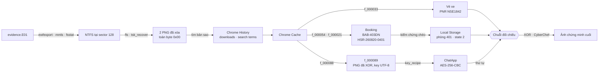

## 1. Phương pháp tiếp cận

Trước hết **liệt kê toàn bộ** những gì có trên đĩa và xác định mỗi file thực chất là gì **dựa vào nội dung, không dựa vào tên**. Sau đó mới khoanh vùng nhóm artifact liên quan (Chrome History, cache, ChatApp…), đọc record bên trong, rồi dùng các mã định danh tìm được để **pivot** sang nguồn khác.

```text
Kiểm kê toàn bộ tệp → xác định loại theo nội dung → chọn nhóm artifact liên quan
→ đọc record → lấy identifier làm pivot → kiểm chứng chéo
```

>  Giống như tìm đồ bị mất trong nhà Nhìn qua cả căn phòng trước, đừng lục ngay cái ngăn kéo đầu tiên. Trong bài này, ta liệt kê hết các file trước rồi mới chọn chỗ cần đọc kỹ.

**Mỗi phát hiện phải trả lời được ba câu hỏi:**

1. Nó đến từ artifact nào?
2. Nó trực tiếp chứng minh điều gì?
3. Có nguồn nào khác giúp kiểm tra kết luận không?

**Tách bạch quan sát, suy luận và kết luận:**

| Định nghĩa   | Ví dụ trong bài                                            |                                                                                         |
| ------------ | ---------------------------------------------------------- | --------------------------------------------------------------------------------------- |
| **Quan sát** | Những gì nhìn thấy hoặc thu được trực tiếp từ bằng chứng   | `ticket_DN1842.png` khôi phục được dài 64120 byte nhưng toàn byte `0x00`                |
| **Suy luận** | Nhận định rút ra từ một hoặc nhiều quan sát                | Dữ liệu ảnh trên đĩa đã mất → phải tìm bản sao ở nguồn khác                             |
| **Kết luận** | Kết quả cuối cùng sau khi đối chiếu và xác nhận bằng chứng | Ảnh vé nguyên vẹn nằm trong Chrome cache (`f_000033`), khớp tên file và mã xe `DN-1842` |

## 2. Chuẩn bị evidence

### 2.1. Kiểm tra hash và chuyển E01 → RAW

Nhận evidence xong, việc đầu tiên là **ghi lại và kiểm tra hash** để chắc chắn bản đang phân tích không bị thay đổi:

```bash
sha256sum evidence.E01
ewfverify evidence.E01     # đối chiếu với hash lưu sẵn bên trong E01
```

Sau đó chuyển sang RAW, vì một số công cụ forensic **không đọc được E01** nhưng đọc được RAW:

```bash
ewfexport -u -f raw -t evidence evidence.E01    # → evidence.raw
```

|Tham số|Ý nghĩa|
|---|---|
|`-u`|Chạy không tương tác (unattended), dùng giá trị mặc định|
|`-f raw`|Định dạng đầu ra là RAW|
|`-t evidence`|Tên file đích → `evidence.raw`|

- **E01** là một **hộp đóng gói** chứa toàn bộ ổ đĩa — dữ liệu đã nén, kèm metadata và hash.
- **RAW** là toàn bộ dữ liệu trong hộp được lấy ra thành **một bản sao ổ đĩa nguyên bản**, từng byte một.

> - Vì sao E01 chỉ ~10 MB mà RAW lên tới ~2 GB? Vì E01 được **nén**, và nén cực kỳ hiệu quả với image có nhiều vùng trống hoặc dữ liệu lặp lại:
> 
> ```text
> 2 GB RAW:
> 00 00 00 00 00 00 00 00 00 00 00 00 00 00 00 00 ...
> 00 00 00 00 00 00 00 00 00 00 00 00 00 00 00 00 ...
> ...
> ```
> 
> Một vùng lớn toàn `00` không cần lưu từng byte — chỉ cần biểu diễn kiểu _"`00` lặp lại rất nhiều lần"_, nên sau khi nén còn cực nhỏ. Khi export ra RAW, mọi byte được bung ra đầy đủ nên file trở lại đúng kích thước ổ đĩa.

### 2.2. Bảng phân vùng — `mmls`

`mmls` hiển thị bố cục phân vùng của đĩa/image: bảng phân vùng, các phân vùng, vùng chưa cấp phát.

```bash
mmls evidence.raw
```

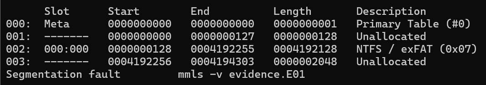

→ Phân vùng **NTFS bắt đầu tại sector 128**, nên mọi lệnh Sleuth Kit phía sau đều kèm `-o 128`.

>  Vì sao là `-o 128` chứ không phải `-o 65536`? `-o` là **offset**, cho Sleuth Kit biết _"filesystem bắt đầu từ sector nào trong image"_. Không có `-o`, Sleuth Kit mặc định filesystem nằm ngay đầu image và sẽ không đọc được NTFS.
> 
> Đơn vị của `-o` là **sector**, không phải byte. Với sector 512 byte, vị trí byte tương ứng là:
> 
> ```text
> 128 × 512 = 65,536 byte
> ```
> 
> nhưng giá trị truyền vào vẫn là số sector: ✅ `-o 128` — ❌ `-o 65536`.

### 2.3. Thông tin filesystem — `fsstat`

`fsstat` hiển thị chi tiết về filesystem: loại, cấu trúc, metadata và thống kê sử dụng.

```bash
fsstat -o 128 evidence.raw
```

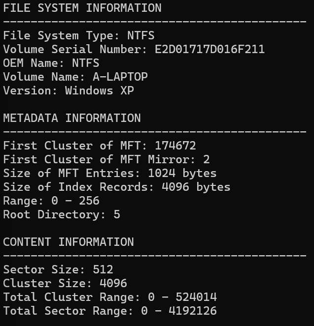

|Trường|Giá trị|Ý nghĩa|
|---|---|---|
|Sector Size|`512`|1 sector = 512 byte|
|Cluster Size|`4096`|1 cluster = 4096 / 512 = **8 sector** (4 KB)|
|Total Cluster Range|`0 - 524014`|524015 cluster × 4096 byte ≈ **2.15 GB** — khớp kích thước RAW|

> Kiến thức nền: MFT, sector và cluster **MFT (Master File Table)** là _"sổ quản lý file"_ của NTFS: mỗi file/thư mục có một entry ghi tên, timestamp, kích thước và vị trí dữ liệu. Khi file bị xóa, entry chỉ bị đánh dấu là không còn dùng — vì vậy `fls` vẫn thấy được tên file đã xóa.
> 
> **Sector** là đơn vị nhỏ nhất của đĩa, **cluster** là đơn vị cấp phát của filesystem:
> 
> ```text
> Cluster
> ┌──────┬──────┬──────┬──────┬──────┬──────┬──────┬──────┐
> │512 B │512 B │512 B │512 B │512 B │512 B │512 B │512 B │
> └──────┴──────┴──────┴──────┴──────┴──────┴──────┴──────┘
>                     = 4096 bytes
> ```

## 3. Liệt kê file và khôi phục file đã xóa

### 3.1. `fls` — liệt kê file

`fls` (The Sleuth Kit) liệt kê file và thư mục trong image **mà không cần mount**, kể cả file đã bị xóa.

```bash
fls -r -p -o 128 evidence.raw
```

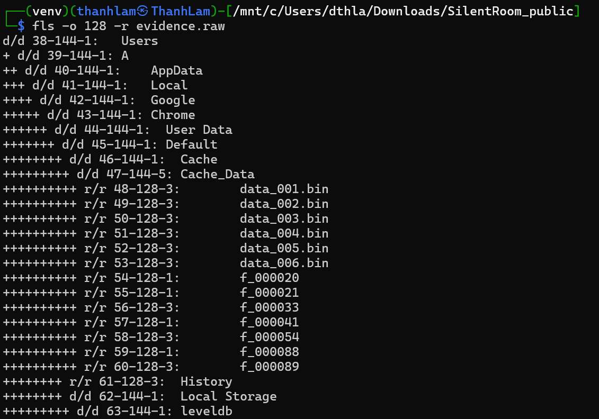

Các đường dẫn quan trọng:

```text
# Chrome
Users/A/AppData/Local/Google/Chrome/User Data/Default/History
Users/A/AppData/Local/Google/Chrome/User Data/Default/Cache/Cache_Data/
Users/A/AppData/Local/Google/Chrome/User Data/Default/Local Storage/leveldb/

# ChatApp
Users/A/AppData/Local/Programs/ChatApp/resources/app.bundle.js
Users/A/AppData/Roaming/ChatApp/Local State
Users/A/AppData/Roaming/ChatApp/msg_cache.db

# Downloads
Users/A/Downloads/booking_BAB_403_receipt.html
Users/A/Downloads/notice_217.pdf
```

Và hai bản ghi **đã bị xóa** (đánh dấu `*`):

```text
-/r * 82-128-3: Users/A/Downloads/booking_HSR_260820_preview.png
-/r * 84-128-3: Users/A/Downloads/ticket_DN1842.png
```

|Ký hiệu|Ý nghĩa|
|---|---|
|`*`|File đã bị xóa|
|`-/r`|Loại file theo directory entry / theo metadata: `-` = không rõ, `r` = file thường|
|`82-128-3`|MFT entry `82` · attribute type `128` (`$DATA`) · attribute id `3`|

### 3.2. `tsk_recover` — khôi phục

```bash
tsk_recover -e -o 128 evidence.raw recovered
```

`-e` trích xuất **tất cả** file mà Sleuth Kit tìm thấy:

- 🟢 **File đang tồn tại** trên filesystem
- 🔴 **File đã bị xóa** nhưng vẫn còn thông tin để khôi phục

```text
Ổ đĩa
├── 48 file đang tồn tại ──→ tsk_recover -e → lấy ra
└──  2 file đã bị xóa    ──→ tsk_recover -e → cũng lấy ra (nếu khôi phục được)
```

>  `tsk_recover` khác `fls -d` thế nào?
> 
> |Lệnh|Tác dụng|
> |---|---|
> |`fls -r -p -d -o 128 evidence.raw`|Chỉ **liệt kê** file đã bị xóa, không khôi phục|
> |`tsk_recover -o 128 evidence.raw out`|Khôi phục **chỉ file đã bị xóa** (mặc định)|
> |`tsk_recover -e -o 128 evidence.raw out`|Khôi phục **tất cả** file|
> 
> Trong bài, `fls -d` trả về đúng hai file: `booking_HSR_260820_preview.png` và `ticket_DN1842.png`.

### 3.3. Ảnh khôi phục được… toàn byte 0

Khôi phục xong, mở hai ảnh lên thì **không được**. Thay vì đoán, kiểm tra trực tiếp nội dung byte:

```bash
python3 - <<'PY'
from pathlib import Path

downloads = Path("recovered/Users/A/Downloads")

for name in ["ticket_DN1842.png", "booking_HSR_260820_preview.png"]:
    data = (downloads / name).read_bytes()
    print(name, "size=", len(data), "nonzero=", sum(b != 0 for b in data))
PY
```

```text
ticket_DN1842.png size= 64120 nonzero= 0
booking_HSR_260820_preview.png size= 61397 nonzero= 0
```

Cả hai file đều **có kích thước** (~60 KB) nhưng **không có byte nào khác 0**. Một PNG thật luôn mở đầu bằng signature `89 50 4E 47 0D 0A 1A 0A`, còn ở đây:

```text
$ xxd -l 16 recovered/Users/A/Downloads/ticket_DN1842.png
00000000: 0000 0000 0000 0000 0000 0000 0000 0000  ................
```

> Quan sát → Suy luận
> 
> - **Quan sát:** MFT vẫn giữ tên và kích thước file, nhưng các cluster dữ liệu chỉ còn byte `0x00`.
> - **Suy luận:** Nội dung ảnh trên đĩa đã bị ghi đè → không thể lấy ảnh từ chính file này, phải tìm **bản sao** ở nguồn khác.

### 3.4. Bản sao thường nằm ở đâu?

Một file bị xóa trên đĩa vẫn có thể còn **bản sao logic** ở nơi khác:

|Nguồn|Là gì|
|---|---|
|**Browser cache**|Dữ liệu website được trình duyệt lưu tạm để tải nhanh hơn|
|**Thumbnail**|Ảnh thu nhỏ được tạo để xem trước ảnh/video|
|**Attachment cache**|Bản sao tạm của file đính kèm từ email, chat hoặc ứng dụng|
|**Backup**|Bản sao dữ liệu để phục hồi khi bản gốc bị mất hoặc hỏng|

Vì vậy hướng tiếp theo là **Chrome, ChatApp, Downloads và các tệp Recent**. Bài này tìm được ảnh nguyên vẹn trong **Chrome cache** — nhưng trước khi lục cache, cần biết hai ảnh được tải **từ đâu** và **lúc nào**: đọc Chrome History.

## 4. Chrome History — dấu vết người dùng

### 4.1. Cấu trúc database `History`

`History` là một database SQLite. Các bảng dùng trong bài:

|Bảng|Chứa gì|
|---|---|
|`urls`|Các URL đã truy cập: tiêu đề, số lần truy cập, lần truy cập cuối|
|`visits`|Từng lượt truy cập kèm thời điểm|
|`downloads`|File đã tải: đường dẫn lưu, thời điểm, kích thước, trạng thái|
|`downloads_url_chains`|Chuỗi URL (kể cả redirect) dẫn tới từng file tải|
|`keyword_search_terms`|Từ khóa người dùng đã tìm kiếm|

### 4.2. Hai hệ timestamp

|Nguồn|Epoch|Đơn vị|
|---|---|---|
|Chrome|1601-01-01 UTC|micro giây|
|ChatApp|1970-01-01 UTC|giây|

Chuyển đổi bằng **số nguyên** với `datetime`/`timedelta`, rồi biểu diễn về cùng múi giờ **+07:00**:

```python
from datetime import datetime, timedelta, timezone

ICT = timezone(timedelta(hours=7))
CHROME_EPOCH = datetime(1601, 1, 1, tzinfo=timezone.utc)
UNIX_EPOCH = datetime(1970, 1, 1, tzinfo=timezone.utc)

def from_chrome(us: int) -> datetime:
    """Chrome: số micro giây kể từ 1601-01-01 UTC."""
    return (CHROME_EPOCH + timedelta(microseconds=us)).astimezone(ICT)

def from_unix(s: int) -> datetime:
    """ChatApp: số giây kể từ 1970-01-01 UTC."""
    return (UNIX_EPOCH + timedelta(seconds=s)).astimezone(ICT)
```

> [!WARNING]
> **Đừng trộn công thức:** Lấy một Unix timestamp rồi áp công thức của Chrome (hoặc ngược lại) sẽ dựng sai **toàn bộ** timeline.

>  Đổi ngay trong SQLite
> 
> ```sql
> SELECT datetime(start_time / 1000000 - 11644473600, 'unixepoch', '+7 hours') FROM downloads;
> ```
> 
> `11644473600` là số giây từ 1601-01-01 đến 1970-01-01.

### 4.3. `downloads` — file đã tải

Mở lại bảng `downloads`: Chrome vẫn giữ đủ **4 bản ghi tải xuống** — kể cả hai PNG đã bị xóa khỏi ổ đĩa — kèm thời điểm tải và URL nguồn.

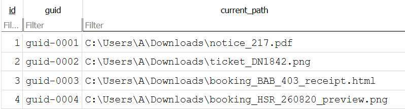

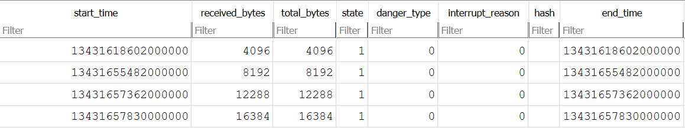

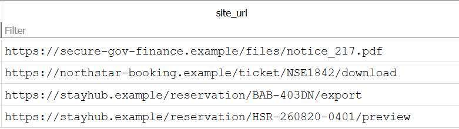

> [!NOTE]
> Xóa file trong `Downloads` **không xóa** bản ghi trong `History`. Biết A đã tải gì, lúc nào và từ URL nào giúp xác định nơi có thể còn bản sao: Chrome cache.

### 4.4. Bối cảnh vụ việc — ba mảnh ghép

Đọc `keyword_search_terms`:

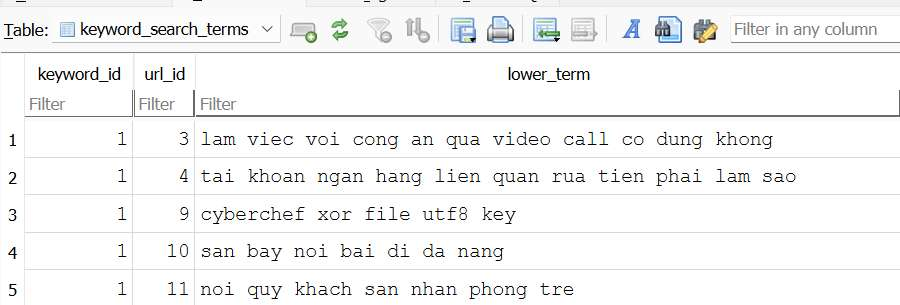

Kết hợp với các artifact khác, có ba mảnh liên quan:

**① Autosave hồ sơ học bổng** — chứa thông tin cá nhân của A.

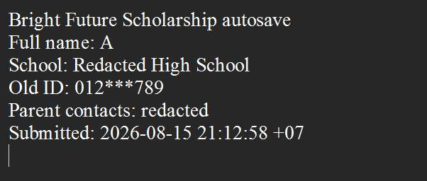

**② PDF "FI-217"** (`notice_217.pdf`) — viện dẫn thông tin định danh của A, yêu cầu giữ liên lạc video và giữ bí mật.

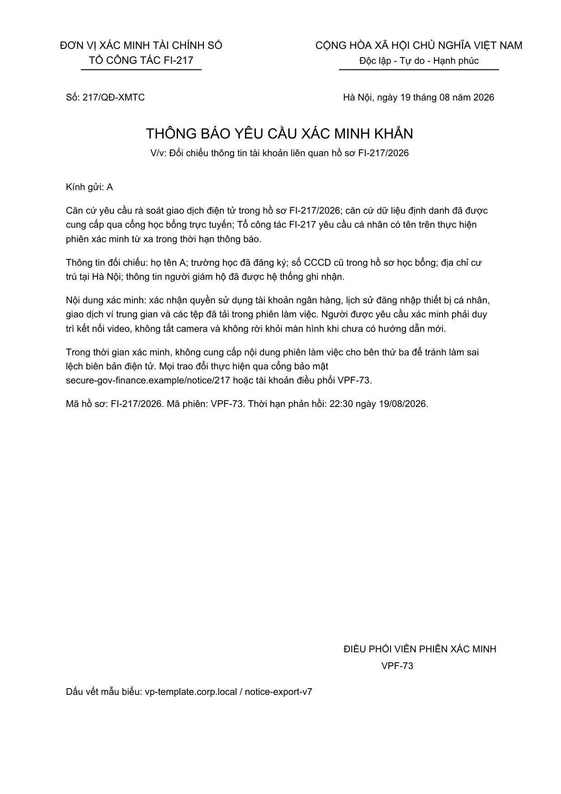

**③ Lịch sử tìm kiếm** (ảnh `keyword_search_terms` ở trên) — A đặt câu hỏi về việc làm việc với công an qua video call và về tài khoản liên quan rửa tiền.

>  Pivot Mã hồ sơ **`FI-217`** trong PDF sẽ là tham số `caseId` để giải mã ChatApp ở mục 7.

## 5. Chrome Cache — bản sao của hai ảnh đã xóa

### 5.1. Nhận diện file theo nội dung

Các file `f_xxxxxx` trong `Cache_Data` chứa nội dung (body) của tài nguyên mà trình duyệt đã tải. Tên file không cho biết loại, nên dùng `file` để nhận diện theo nội dung:

```bash
CACHE="recovered/Users/A/AppData/Local/Google/Chrome/User Data/Default/Cache/Cache_Data"
find "$CACHE" -maxdepth 1 -type f -exec file {} \;
```

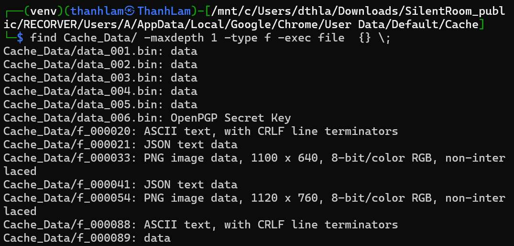

Sau đó kiểm tra từng file đáng chú ý.

### 5.2. `f_000033` — vé xe

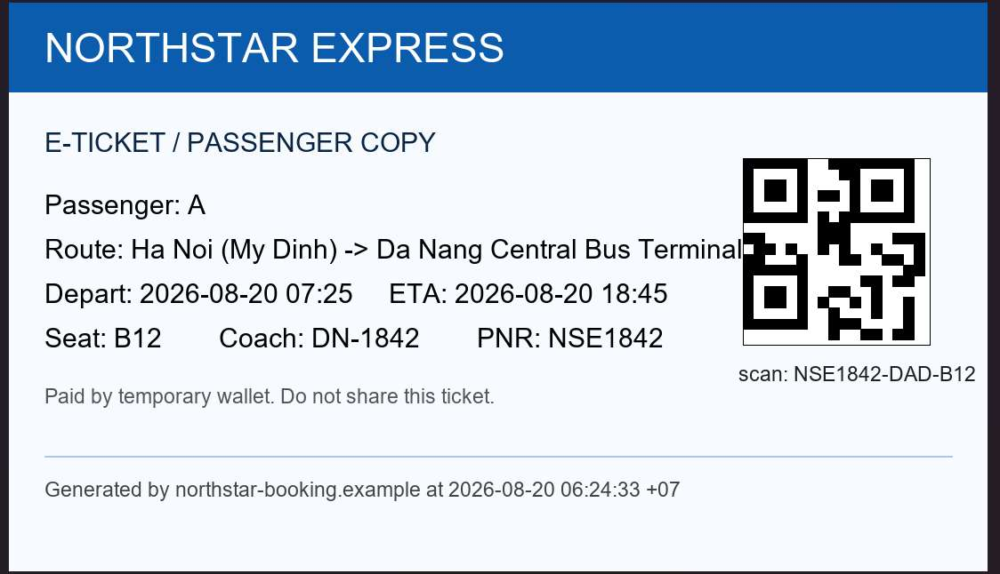

Đây chính là bản sao nguyên vẹn của `ticket_DN1842.png` đã bị xóa. Trên vé có ba mã rất dễ nhầm:

|Trường|Giá trị|Ý nghĩa|
|---|---|---|
|**PNR**|`NSE1842`|_Passenger Name Record_ — **mã hồ sơ đặt vé**, dùng để nhận diện booking|
|Coach|`DN-1842`|Mã xe/chuyến xe — **không phải PNR**|
|Seat|`B12`|Số ghế|

> [!WARNING]
> **PNR cần dùng là `NSE1842`:** Tên file `ticket_DN1842.png` và mã xe `DN-1842` dễ khiến ta lấy nhầm `DN1842`. Khi cần **mã đặt vé**, giá trị đúng là `NSE1842`.

### 5.3. `f_000054` — booking, và một reservation khác

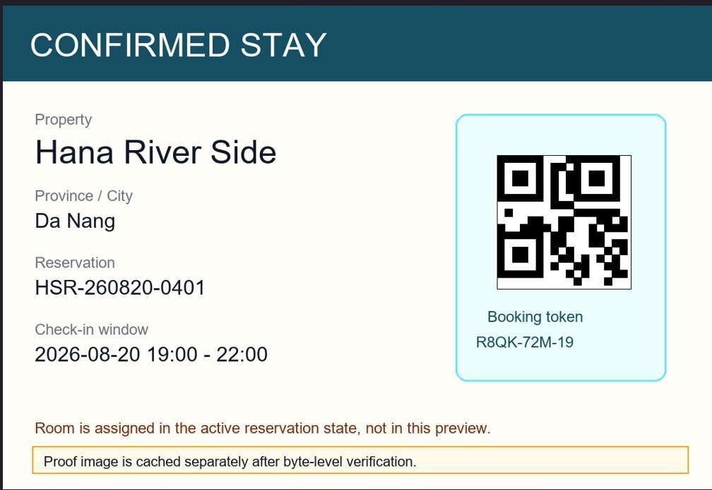

`f_000054` là ảnh booking (bản sao của `booking_HSR_260820_preview.png`). Nhưng trong `Downloads`, người dùng còn **một reservation khác** (`booking_BAB_403_receipt.html`):

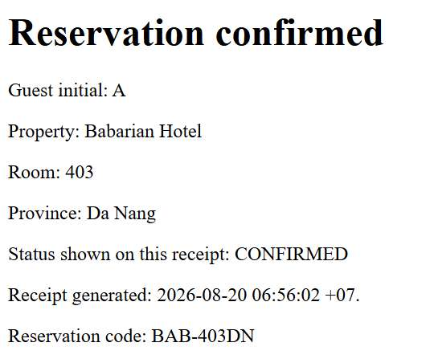

Hai reservation khác nhau → cần kiểm chứng xem cái nào còn hiệu lực.

### 5.4. `f_000021` — lịch sử trạng thái

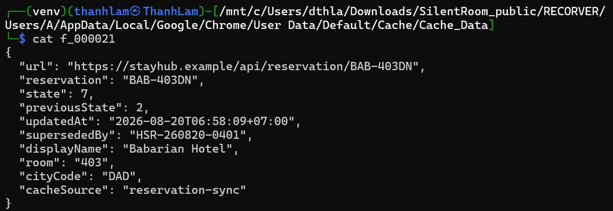

`f_000021` có **hai trạng thái**, trong đó trạng thái trước đó là `7`. Lần theo manh mối này:

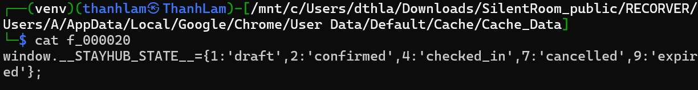

→ Reservation lúc **06:56** trước đó — chính là `BAB-403DN` trong `Downloads` — **đã bị hủy**:

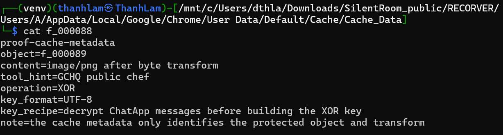

### 5.5. `f_000088` — chỉ dẫn giải mã `f_000089`


|Trường|Giá trị|Ý nghĩa|
|---|---|---|
|`object`|`f_000089`|Đối tượng cần xử lý|
|`content`|`image/png`|Kết quả sau giải mã là ảnh PNG|
|`operation`|`XOR`|Dùng phép XOR|
|`key_format`|`UTF-8`|Key được xử lý dưới dạng UTF-8|
|`key_recipe`|`decrypt ChatApp messages`|Phải giải mã ChatApp trước để biết cách tạo key|
|`tool_hint`|`GCHQ public chef`|Gợi ý dùng **CyberChef** (công cụ của GCHQ)|

> Pivot `f_000088` chỉ thẳng sang ChatApp. Nhưng trước hết cần chốt booking nào còn hiệu lực → kiểm chứng chéo với **Local Storage**.

## 6. Local Storage — kiểm chứng chéo booking

Chrome lưu `localStorage` của các trang web trong LevelDB. Thư mục `Local Storage/leveldb/` có 3 file:

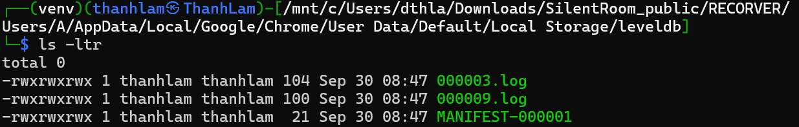

LevelDB ghi theo kiểu **append**: giá trị cũ không bị xóa ngay mà còn nằm lại trong file log cũ — nhờ vậy thấy được cả lịch sử thay đổi.

**`000003.log`** — bản ghi cũ:

```text
stayhub:last_viewedBAB-403DNstate=7replace_with=HSR-260820-0401updated=2026-08-20T06:58:09+07:00
```

**`000009.log`** — bản ghi mới:

```text
activeReservationHSR-260820-0401lodgingRef=R8QK-72M-19roomNumber=401state=2mapPinKey=M-4412
```

**`CURRENT`** — log đang được dùng:

```text
CURRENT: 000009.log
```

|`000003.log` (cũ)|`000009.log` (đang dùng)|
|---|---|---|
|Reservation|`BAB-403DN`|`HSR-260820-0401`|
|`state`|`7` — đã hủy|`2`|
|Chi tiết|`replace_with=HSR-260820-0401`<br>`updated=2026-08-20T06:58:09+07:00`|`lodgingRef=R8QK-72M-19`<br>`roomNumber=401`<br>`mapPinKey=M-4412`|

>  Kết luận `BAB-403DN` đã bị hủy (`state=7`) và được thay bằng `HSR-260820-0401` lúc **06:58:09 ngày 2026-08-20 (+07:00)** — khớp với `f_000021`. Booking còn hiệu lực: **`HSR-260820-0401` — phòng `401`, `state=2`**.

## 7. ChatApp — giải mã tin nhắn

Manh mối `key_recipe` trong `f_000088`, cộng với các hành vi đáng ngờ của A, dẫn tới ChatApp.

### 7.1. `msg_cache.db` — tin nhắn bị mã hóa

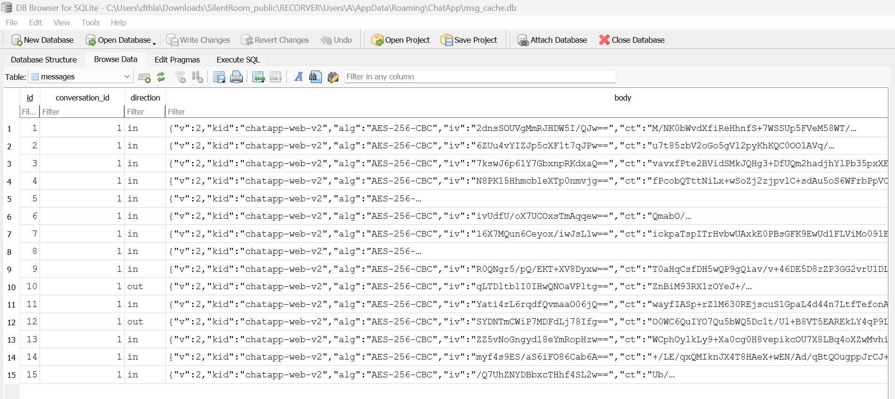

Trường `body` không phải plaintext mà là một JSON chứa thông tin mã hóa:

```json
{
  "v": 2,
  "kid": "chatapp-web-v2",
  "alg": "AES-256-CBC",
  "iv": "...",
  "ct": "..."
}
```

> Đừng brute-force ngay AES-256 không thể brute-force. Trước tiên cần tìm **key** và hiểu cách giải mã — key thường được dẫn xuất từ dữ liệu có sẵn trên máy, nên hãy tìm code của ứng dụng.

### 7.2. Công thức tạo key trong `app.bundle.js`

Code của ChatApp nằm ở `AppData/Local/Programs/ChatApp/resources/app.bundle.js`:

```js
const crypto = require("crypto");

const ChatAppCrypto = {
    kid: "chatapp-web-v2",

    deriveKey: function(peer, caseId) {
        return crypto.createHash("sha256")
            .update([this.kid, peer, caseId].join("|"), "utf8")
            .digest();
    },

    decryptBody: function(body, peer, caseId) {
        const m = JSON.parse(body);

        if (m.alg !== "AES-256-CBC") {
            throw new Error("unsupported");
        }

        const d = crypto.createDecipheriv(
            "aes-256-cbc",
            this.deriveKey(peer, caseId),
            Buffer.from(m.iv, "base64")
        );

        return Buffer.concat([
            d.update(Buffer.from(m.ct, "base64")),
            d.final()
        ]).toString("utf8");
    }
};

module.exports = ChatAppCrypto;
```

`deriveKey()` nối `kid`, `peer`, `caseId` bằng dấu `|`, băm SHA-256 và lấy **32 byte thô** (`.digest()` không truyền encoding) làm key AES-256. `kid` đã có sẵn, chỉ còn thiếu `peer` và `caseId`:

- **`kid` = `chatapp-web-v2`** — có sẵn trong code và trong JSON của mỗi tin nhắn.
- **`peer` = `fi-operator-73`** — ID của đầu mối ở phía bên kia cuộc chat, có vẻ là bên "vận hành phiên xác minh tài chính".
- **`caseId` = `FI-217`** — mã hồ sơ đã gặp trong PDF ("Hồ sơ FI-217/2026"); phần dùng làm `caseId` chỉ là `FI-217`.

Chuỗi đưa vào SHA-256:

```text
chatapp-web-v2|fi-operator-73|FI-217
```

>  Key nằm ngay trên máy Công thức tạo key (trong code) và các tham số (trong artifact khác) đều có sẵn trên máy của A → khôi phục được toàn bộ chat mà không cần brute-force.

### 7.3. Script giải mã

>  IV là gì? **IV (Initialization Vector)** là 16 byte đi kèm mỗi bản mã AES-CBC, giúp cùng một plaintext mã hóa ra các ciphertext khác nhau. IV **không phải bí mật** nên được lưu ngay trong JSON (dạng Base64); thứ cần giữ kín là **key**.
> 
> ```text
> alg → thuật toán (AES-256-CBC)
> iv  → Base64 của IV (16 byte)
> ct  → Base64 của ciphertext
> ```

Luồng giải mã:

```text
kid|peer|caseId
       ↓  SHA-256 → digest()
  AES key (32 byte)

m.iv
       ↓  Base64 decode
  IV (16 byte)

AES key + IV + ciphertext (Base64 decode m.ct)
       ↓  AES-256-CBC, bỏ padding PKCS#7
  plaintext (UTF-8)
```

Script Python làm lại đúng các bước của `decryptBody()` cho mọi tin nhắn trong `msg_cache.db`:

```python
import base64
import hashlib
import json
import sqlite3

from Crypto.Cipher import AES              # pip install pycryptodome
from Crypto.Util.Padding import unpad

DB = "recovered/Users/A/AppData/Roaming/ChatApp/msg_cache.db"
KID, PEER, CASE_ID = "chatapp-web-v2", "fi-operator-73", "FI-217"

# Giống deriveKey(): SHA-256 → 32 byte thô (digest(), KHÔNG phải hexdigest())
KEY = hashlib.sha256(f"{KID}|{PEER}|{CASE_ID}".encode("utf-8")).digest()


def try_decrypt(value):
    """Giải mã nếu value là JSON mã hóa của ChatApp, ngược lại trả về None."""
    if not isinstance(value, str):
        return None
    try:
        m = json.loads(value)
    except ValueError:
        return None
    if not (isinstance(m, dict) and m.get("alg") == "AES-256-CBC"):
        return None
    cipher = AES.new(KEY, AES.MODE_CBC, base64.b64decode(m["iv"]))
    plaintext = unpad(cipher.decrypt(base64.b64decode(m["ct"])), AES.block_size)
    return plaintext.decode("utf-8")       # key sai → báo lỗi padding/UTF-8 ngay tại đây


con = sqlite3.connect(DB)
cur = con.execute("SELECT * FROM messages")
cols = [c[0] for c in cur.description]

count = 0
with open("chat_decrypted.txt", "w", encoding="utf-8") as out:
    for i, row in enumerate(cur, 1):
        out.write(f"========== MESSAGE {i} ==========\n")
        for col, val in zip(cols, row):
            text = try_decrypt(val)
            if text is not None:
                count += 1
            out.write(f"{col}: {val if text is None else text}\n")
        out.write("\n")
con.close()

print(f"Đã giải mã {count} tin nhắn → chat_decrypted.txt")
```

> [!TIP]
> **Làm sao biết key đúng?** Với AES-CBC, key sai gần như luôn làm `unpad()` báo lỗi padding, hoặc ra byte rác không decode được UTF-8. Script cố ý để lỗi nổi lên thay vì bỏ qua im lặng — giải mã trọn vẹn cả 15 tin nhắn ra tiếng Việt đọc được chính là xác nhận key đúng.

### 7.4. Nội dung chat sau giải mã

`op` = `fi-operator-73`

|#|Người gửi|Nội dung|Manh mối|
|--:|:-:|---|---|
|1|op|Em không được để lại lời nhắn. Nếu gia đình biết, hồ sơ sẽ chuyển sang mức khẩn cấp.|Cô lập nạn nhân khỏi gia đình|
|2|op|Họ tên, trường học, CCCD cũ và địa chỉ nhà của em đều nằm trong hồ sơ FI-217. Đừng thử thách hệ thống.|Nhắc lại hồ sơ `FI-217` — khớp `caseId`|
|3|op|Nếu tắt camera, gọi cho bố mẹ, hoặc rời màn hình quá 30 giây, biên bản sẽ ghi là tự ý cản trở điều tra.|Ép giữ camera, cấm liên lạc|
|4|op|Em chỉ có một cách chứng minh trong sạch: làm đúng từng bước và giữ im lặng cho đến khi có lệnh mới.||
|5|op|Tài khoản của em đang bị đồng bộ với ví trung gian. Một thao tác sai sẽ khóa tài sản của cả gia đình.|Đe dọa tài sản gia đình|
|6|op|Mở vé xe, xác nhận PNR rồi ghi nhớ. PNR là một phần khóa đối chiếu, không đọc cho ai.|**PNR là một phần của khóa**|
|7|op|Sau khi xem xong vé và booking, xóa file tải về. Không cần xóa trình duyệt.|**Vì sao Chrome cache còn bản sao**|
|8|op|Nếu có ai hỏi, nói em đang ra sân bay. Không đi theo điểm đỗ nếu chưa có lệnh mới.|Dựng lời khai giả|
|9|op|Ảnh đặt phòng cũ chỉ là bản chụp tại thời điểm đó. Trạng thái trong hệ thống mới là lệnh hợp lệ.|**Tin trạng thái hệ thống, không tin ảnh cũ**|
|10|**A**|Em run quá, em làm sai thì có bị bắt không?||
|11|op|Bình tĩnh và làm nhanh. Em đang được đánh dấu là hợp tác, đừng đổi trạng thái từ xác nhận sang khẩn cấp.||
|12|**A**|Em đã xóa vé và ảnh booking rồi.|Khớp hai PNG bị xóa|
|13|op|Chỉ làm theo mã còn hiệu lực trong trang đặt phòng. Đừng tin ảnh chụp cũ nếu hệ thống đã cập nhật.|**Chỉ dùng booking còn hiệu lực**|
|14|op|Ảnh chứng minh cuối đã khóa theo XOR bằng chuỗi đối chiếu. Nếu máy không mở được, tìm CyberChef và dùng key UTF-8.|**Khớp chỉ dẫn trong `f_000088`**|
|15|op|Thứ tự chuỗi đối chiếu: Mã PNR vé xe\|trạng thái đặt phòng bằng chữ\|Số phòng\|tên nơi ở viết liền\|tỉnh thành viết liền.|**Thứ tự chuỗi đối chiếu**|

>  Bức tranh toàn cảnh _(suy luận)_ Nội dung chat, PDF `FI-217` và lịch sử tìm kiếm khớp với kịch bản lừa đảo kiểu **"bắt cóc online"**: giả danh cơ quan điều tra, dùng thông tin cá nhân bị lộ để gây áp lực, buộc nạn nhân giữ video call, cắt liên lạc với gia đình, dựng lời khai giả ("đang ra sân bay") và xóa dấu vết. Tin #7 và #12 cũng giải thích vì sao hai ảnh biến mất khỏi `Downloads` nhưng vẫn còn trong Chrome cache.

## 8. Giải mã `f_000089`

### 8.1. Ghép chuỗi đối chiếu

Theo tin nhắn #15, thứ tự các thành phần là:

```text
Mã PNR vé xe|trạng thái đặt phòng bằng chữ|Số phòng|tên nơi ở viết liền|tỉnh thành viết liền
```

|#|Thành phần|Giá trị|Lấy từ|
|--:|---|---|---|
|1|Mã PNR vé xe|`NSE1842`|`f_000033` — **không phải** Coach `DN-1842`|
|2|Trạng thái đặt phòng bằng chữ|`<TRẠNG_THÁI>`|`state=2` trong `000009.log` — trạng thái hệ thống, không lấy theo ảnh cũ (tin #9, #13)|
|3|Số phòng|`401`|`roomNumber=401` trong `000009.log`|
|4|Tên nơi ở viết liền|`<TÊN_NƠI_Ở>`|Booking `HSR-260820-0401`|
|5|Tỉnh thành viết liền|`<TỈNH_THÀNH>`|Booking `HSR-260820-0401`|

```text
NSE1842|<TRẠNG_THÁI>|401|<TÊN_NƠI_Ở>|<TỈNH_THÀNH>
```

Từ đó key đầy đủ sẽ là 

```cs
NSE1842|confirmed|401|HanaRiverSide|DaNang
```

> [!TIP]
> **Kiểm chứng sớm bằng known-plaintext:** `content=image/png` cho biết trước 16 byte đầu của plaintext: mọi file PNG đều mở đầu bằng `89 50 4E 47 0D 0A 1A 0A 00 00 00 0D 49 48 44 52` (signature + header chunk `IHDR`). XOR chúng với 16 byte đầu của `f_000089` sẽ lộ ra 16 byte đầu của khóa:
> 
> ```python
> from pathlib import Path
> 
> CACHE = Path("recovered/Users/A/AppData/Local/Google/Chrome/User Data/Default/Cache/Cache_Data")
> enc = (CACHE / "f_000089").read_bytes()
> 
> png_head = bytes.fromhex("89504e470d0a1a0a0000000d49484452")   # 16 byte đầu của mọi file PNG
> print(bytes(a ^ b for a, b in zip(enc, png_head)))               # → 16 byte đầu của khóa
> ```
> 
> Nếu kết quả bắt đầu bằng `NSE1842|` thì phần PNR đã đúng (và không phải `DN1842`) — một bước kiểm chứng chéo trước khi XOR toàn bộ file.

### 8.2. XOR trong CyberChef

Mở [CyberChef](https://gchq.github.io/CyberChef/), nạp `f_000089` làm input rồi dùng recipe:

|Thiết lập|Giá trị|
|---|---|
|Operation|**XOR**|
|Key|Chuỗi đối chiếu ở trên, định dạng **UTF8**|
|Scheme|Standard|

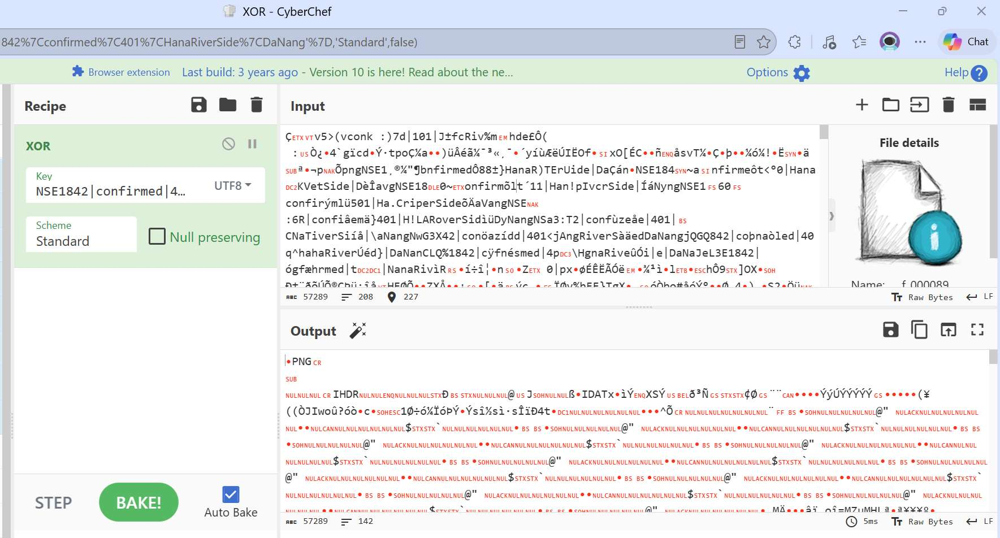

> [!WARNING]
> **Nếu chuỗi đối chiếu có dấu tiếng Việt:** Mỗi ký tự có dấu chiếm 2–3 byte trong UTF-8, và **dạng dựng sẵn (NFC) khác dạng tổ hợp (NFD)** — cùng một chữ nhìn giống hệt nhau nhưng ra byte khác:
> 
> ```text
> à  NFC: C3 A0       NFD: 61 CC 80
> ẵ  NFC: E1 BA B5    NFD: 61 CC 86 CC 83
> ```
> 
> Chọn sai định dạng key (Latin1, Hex…) hoặc gõ/dán chuỗi ở dạng tổ hợp đều làm sai dãy byte khóa → XOR ra file hỏng.

### 8.3. Hoặc bằng Python

```python
import struct
import zlib
from itertools import cycle
from pathlib import Path

CACHE = Path("recovered/Users/A/AppData/Local/Google/Chrome/User Data/Default/Cache/Cache_Data")
KEY = "NSE1842|<TRẠNG_THÁI>|401|<TÊN_NƠI_Ở>|<TỈNH_THÀNH>".encode("utf-8")   # điền giá trị thật

enc = (CACHE / "f_000089").read_bytes()
dec = bytes(b ^ k for b, k in zip(enc, cycle(KEY)))


def png_intact(data: bytes) -> bool:
    """Signature và CRC của mọi chunk đều khớp → toàn bộ khóa đúng."""
    if data[:8] != b"\x89PNG\r\n\x1a\n":
        return False
    pos = 8
    while pos + 12 <= len(data):
        length, ctype = struct.unpack(">I4s", data[pos:pos + 8])
        chunk = data[pos + 4:pos + 8 + length]                   # type + data
        crc = data[pos + 8 + length:pos + 12 + length]
        if len(crc) < 4 or zlib.crc32(chunk) != int.from_bytes(crc, "big"):
            return False
        if ctype == b"IEND":
            return True
        pos += 12 + length
    return False


assert png_intact(dec), "Sai khóa: PNG giải ra bị hỏng"
Path("final.png").write_bytes(dec)
```

> [!WARNING]
> **Có signature PNG chưa chắc đã đúng khóa:** 8 byte đầu của khóa luôn là `NSE1842|`, nên chỉ cần PNR đúng là output đã mở đầu bằng signature PNG — kể cả khi phần sau của khóa sai. Vì vậy script kiểm tra CRC của **mọi** chunk (hoặc đơn giản: mở ảnh ra xem có hiển thị trọn vẹn không).

## 9. Kết quả

Lưu output thành file PNG và mở ra:
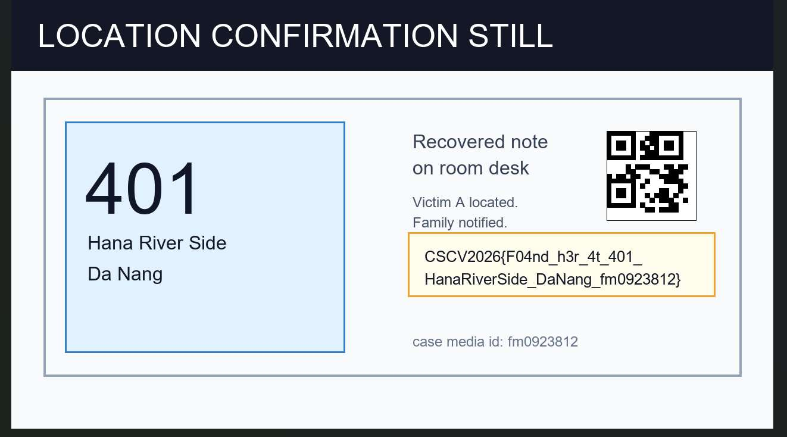

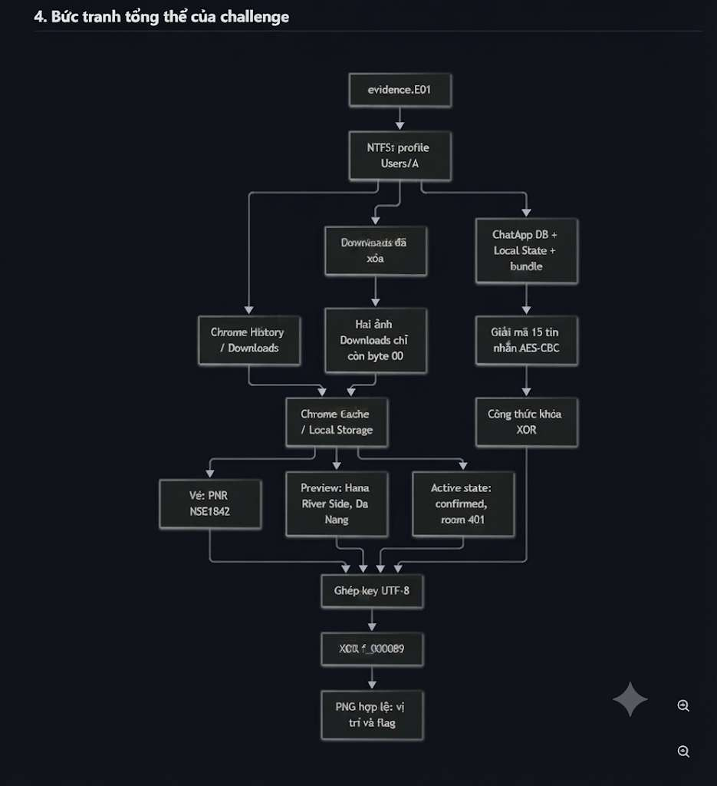

## 10. Tổng kết bằng chứng

|Artifact|Quan sát|Suy luận|
|---|---|---|
|`fls`, `tsk_recover`|2 PNG trong `Downloads` đã bị xóa (MFT entry 82, 84); nội dung khôi phục toàn `0x00`|Không lấy được ảnh từ đĩa → cần bản sao|
|Chrome History|`downloads` vẫn còn bản ghi của 2 PNG; từ khóa tìm kiếm về công an, video call, tài khoản rửa tiền|A đã tải vé và booking; A đang bị dẫn dắt|
|Chrome Cache `f_000033`, `f_000054`|Ảnh vé xe (PNR `NSE1842`) và ảnh booking còn nguyên|Bản sao của hai file đã xóa|
|`f_000021`, `000003.log`|`BAB-403DN` chuyển `state=7`, được thay bằng `HSR-260820-0401` lúc 06:58:09|Booking cũ đã hủy|
|`000009.log`|`HSR-260820-0401`, phòng `401`, `state=2`|Booking còn hiệu lực → dùng cho khóa|
|`app.bundle.js`, `msg_cache.db`|AES-256-CBC, key = SHA-256 của `kid`, `peer`, `caseId`|Giải mã được 15 tin nhắn, trong đó có công thức khóa|
|`f_000088`, `f_000089`|PNG bị XOR với key UTF-8|XOR với chuỗi đối chiếu → ảnh chứng minh cuối|

## 11. Sai lầm thường gặp

| Sai lầm                                             | Cách đúng                                                                                   |
| --------------------------------------------------- | ------------------------------------------------------------------------------------------- |
| Truyền byte offset cho `-o` (`-o 65536`)            | `-o` của Sleuth Kit tính bằng **sector** → `-o 128`                                         |
| Thấy tên file khôi phục là tưởng có ảnh             | Kiểm tra kích thước, byte và signature trước khi mở                                         |
| Dừng lại khi file khôi phục toàn byte 0             | Tìm bản sao: browser cache, thumbnail, attachment cache, backup                             |
| Áp công thức Chrome cho Unix timestamp              | Mỗi nguồn một epoch và đơn vị — Chrome: micro giây từ 1601, ChatApp: giây từ 1970           |
| Tin ảnh chụp/biên nhận cũ (`BAB-403DN`)             | Dùng trạng thái hiện hành trong Local Storage (`000009.log`)                                |
| Brute-force AES                                     | Đọc `app.bundle.js` để lấy công thức tạo key                                                |
| Dùng `hexdigest()` (64 ký tự hex) làm key           | Dùng `digest()` — 32 byte thô, đúng độ dài key AES-256                                      |
| Dùng `FI-217/2026` làm `caseId`                     | Dùng `FI-217` — chỉ cần sai một ký tự, SHA-256 đã cho key khác hoàn toàn                    |
| Thấy output XOR có signature PNG là tưởng khóa đúng | Signature chỉ phụ thuộc 8 byte đầu của khóa (phần PNR) → kiểm tra CRC các chunk hoặc mở ảnh |
| Gõ chuỗi có dấu bằng bảng mã tổ hợp (NFD)           | Dùng Unicode dựng sẵn (NFC) và chọn key format **UTF8**                                     |

## Tham khảo

- [The Sleuth Kit — danh sách lệnh](https://wiki.sleuthkit.org/The-Sleuth-Kit-commands/) · [`fls` man page](http://sleuthkit.org/sleuthkit/man/fls.html)
- [libewf](https://github.com/libyal/libewf) — `ewfverify`, `ewfexport`
- [CyberChef](https://gchq.github.io/CyberChef/)